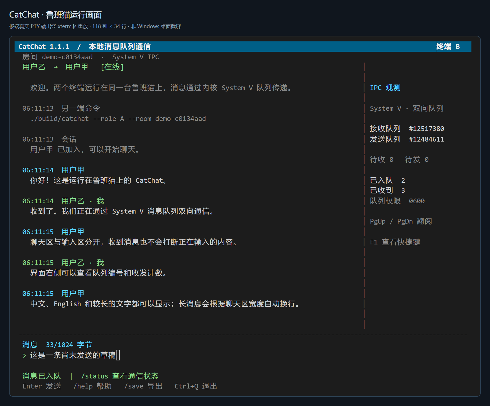

# CatChat · 鲁班猫本地消息队列聊天

C 语言实现的双人全屏终端聊天程序。两个独立进程运行在**同一台 Linux 主机、同一 IPC 命名空间**中，聊天消息通过 **System V 消息队列**传递。

当前版本：**1.1.1**。默认昵称为“用户甲 / 用户乙”，启动与 `/help` 会显示另一端的加入命令；支持 `--name` 自定义昵称。已在鲁班猫 aarch64 上验证。

电脑可以打开两个 SSH 窗口连接同一块鲁班猫。SSH 负责终端连接；A、B 之间的数据通道是板端消息队列。



图为实际鲁班猫 PTY 输出经 xterm.js 重放的画面，展示中文收发、IPC 观测与未发送草稿；不是 Windows 桌面原生截屏。

## 快速运行

需要 Linux、C11 编译器、Make；测试另需 Python 3。程序运行不依赖 ncurses、网络服务或额外 C 库，也不需要 root。

板端项目路径：`/home/cat/catchat-ipc-course`。以下命令在鲁班猫终端执行。

```sh
cd /home/cat/catchat-ipc-course
make -j2
```

终端一：

```sh
cd /home/cat/catchat-ipc-course
./build/catchat --role A --room demo
```

终端二：

```sh
cd /home/cat/catchat-ipc-course
./build/catchat --role B --room demo
```

两端的房间名必须一致、角色必须不同。默认房间为 `demo`。支持先启动任意一端；另一端加入后即可聊天。一个房间最多两个端点，允许在不同房间运行多组独立会话。

以上两条命令分别使用“用户甲”和“用户乙”。若追加 `--name '其他昵称'`，会优先使用自定义值；旧命令里显式写入的昵称不会被默认值覆盖。

## 界面与交互

- 彩色全屏界面，聊天记录、独立输入行、在线状态分区显示。
- 窗口至少 106 列 × 26 行时显示 IPC 侧栏；较窄或较矮时隐藏侧栏，可用 `/status` 查看相同信息。
- 最小显示尺寸 60 列 × 18 行，推荐 118 列 × 34 行。窗口过小时提示调整，通信继续运行。
- UTF-8 中文昵称、中文输入、长消息自动换行；输入较长时水平滚动。
- 英文单词、路径和数字尽量整体换行；超出整行的长词仍可折行。
- 收到消息时保留输入草稿和光标位置。支持左右键、Home/End、Delete、Backspace。
- 翻阅历史期间保持原来的显示位置，并提示新到的消息数量；Ctrl+G 回到最新消息。
- 每条消息最多 **1024 UTF-8 字节**；例如常用汉字通常占 3 字节。超限会提示，超限内容不会自动发送。
- 昵称最多 31 字节、16 个终端列。使用 ASCII、常用中文及普通标点最稳妥；复杂 emoji 字形组合的显示取决于终端与字体。
- 拒绝仅含普通空格、全角空格等空白的昵称与消息。
- 保留本端最近 300 条消息及系统事件；不自动写入磁盘。`/save` 可显式导出当前记录。
- 队列满或对方离线时保留草稿，待对方在线、队列可用后按 Enter 重试。
- 对端正常退出或进程异常终止后提示离线，允许相同角色重新加入。重新加入的进程不会接收旧进程遗留的消息。
- 消息计数中的“已入队”表示内核接受发送，**不代表已读回执**。本项目不提供离线消息服务。

| 操作 | 功能 |
|---|---|
| Enter | 发送消息或执行命令 |
| 左右键 / Home / End | 移动输入光标 |
| Backspace / Delete | 按 Unicode 码点删除 |
| Ctrl+U | 清空输入 |
| PgUp / PgDn | 翻阅本端历史 |
| Ctrl+G | 回到最新消息并清除新消息提示 |
| F1 或 `/help` | 查看帮助 |
| `/status` | 队列编号、待收/待发条数、容量与计数 |
| `/clear` | 清空本端聊天显示和内存记录 |
| `/save` | 在当前工作目录导出记录，权限 0600；连续导出自动编号，不覆盖已有文件 |
| `/quit`、Ctrl+Q、Ctrl+C | 退出并恢复终端 |
| `//help` | 发送文字 `/help`，不执行命令 |

终端支持 bracketed paste 时，多行粘贴会合并为空格，须按 Enter 才发送。程序退出会恢复原始终端设置。`SIGKILL` 无法被程序捕获；若人为强杀全屏进程导致终端模式异常，可在该 SSH 窗口执行 `stty sane`，再执行 `reset`。不要为此结束其他项目。

## 查看与清理本项目会话

```sh
./build/catchat --room demo --inspect
./build/catchat --room demo --cleanup
```

`--inspect` 显示该房间的在线端点和队列状态；`--cleanup` 拒绝清理仍有在线端点的房间。正常情况下，最后一端退出会删除两个队列。若两端均被强杀，下次启动同房间会恢复并回收原会话队列，也可显式清理。

运行时元数据独立放在 `/tmp/catchat-ipc-course-<UID>/<room>/`。目录权限 0700、文件与消息队列权限 0600。锁文件保留用于避免删除后重建产生的锁竞争，通常每个房间只占少量磁盘空间。

程序只管理记录在本房间状态文件中、且身份属性匹配的队列。不要执行全局 `ipcrm -a` 或按宽泛名称终止进程。其他项目的文件、终端和队列不属于本项目。

若状态文件损坏或队列身份属性不一致，程序会停止自动回收并保留记录，供检查该房间。锁被占用时，界面仍可编辑、接收与退出；发送草稿会保留。启动、检查和退出阶段的锁等待有约 1 秒上限，不无限等待。

## 构建与测试

```sh
make                     # GCC/Clang，严格警告作为错误
make check               # 真实进程、真实消息队列、真实 PTY 的集成测试
make sanitize            # AddressSanitizer + UndefinedBehaviorSanitizer 检查
./build/catchat --help
```

测试只使用随机命名的专用房间，并核对测试前后的消息队列 ID 清单，避免遗留资源或影响原有队列。详见 [tests/integration.py](tests/integration.py)。

每次测试将逐终端原始输出、诊断命令输出和 `index.json` 保存至 `evidence/test-logs/test-<随机标识>/`，失败时也保留。`.ansi` 为全屏终端原始字节流，`.log` 为行式输出；索引包含测试名称、角色、PID 和退出码。可通过 `CATCHAT_TEST_LOG_DIR` 指定日志根目录。测试日志不会自动进入 Git 仓库。

`make check` 还检查换行、历史位置与新消息计数。14 组集成测试覆盖正常聊天及锁占用、元数据损坏、身份不匹配、连续导出、并发启动/退出，以及 300 条长消息的显示边界。诊断版在本板退出时的泄漏扫描较慢，完整 `make sanitize` 可能需要数分钟。

可执行文件先链接到临时文件，再以重命名替换。因此重新构建不会覆盖正在运行进程映射的文件；已有聊天进程继续使用旧版，退出并重新启动后使用新版。

可用 `--plain` 开启行式诊断模式，消息仍通过相同的 System V 队列传递。全屏模式使用 ANSI 256 色终端控制序列。程序会优先采用环境的 UTF-8 locale；默认 POSIX/C 环境下尝试 `C.UTF-8`。

消息时间取板端系统时钟；若板载时钟未校准，显示的时间与导出文件名也会相应偏差。程序不修改系统时间。

## 目录

```text
src/main.c           参数解析、输入事件循环、命令、信号处理
src/ipc.c            会话隔离、System V 队列、角色锁、资源生命周期
src/ui.c             ANSI 全屏渲染、编辑器、滚动、导出
src/text.c           UTF-8 校验、Unicode 宽度与字符边界
tests/integration.py 实际 IPC 与 PTY 集成测试
tests/ui_behavior.c   换行、历史锚定与新消息提示专项检查
tests/capture_demo.py 采集板端真实 PTY 输出，供界面检查
docs/DESIGN.md       原理、协议、边界和验证方法
Makefile             构建与测试入口
```

代码和构建说明供 GitHub 仓库使用；课程实验报告另行制作，不包含在这个源码仓库中。

启动引导与逐终端测试日志的组织方式参考了同板项目 `sysv-chat-v1`，由本项目独立实现。对照与取舍见 [参考项目阅读笔记](docs/REFERENCE_NOTES.md)。

## 原理资料

- [System V IPC 接口总览](https://man7.org/linux/man-pages/man7/sysvipc.7.html)
- [msgsnd / msgrcv](https://man7.org/linux/man-pages/man2/msgop.2.html)
- [msgctl](https://man7.org/linux/man-pages/man2/msgctl.2.html)
- [flock](https://man7.org/linux/man-pages/man2/flock.2.html)
- [poll](https://man7.org/linux/man-pages/man2/poll.2.html)
- [wcwidth](https://man7.org/linux/man-pages/man3/wcwidth.3.html)
- [Unicode 15.1 White_Space 定义](https://raw.githubusercontent.com/unicode-org/unicodetools/main/unicodetools/data/ucd/15.1.0/PropList.txt)
